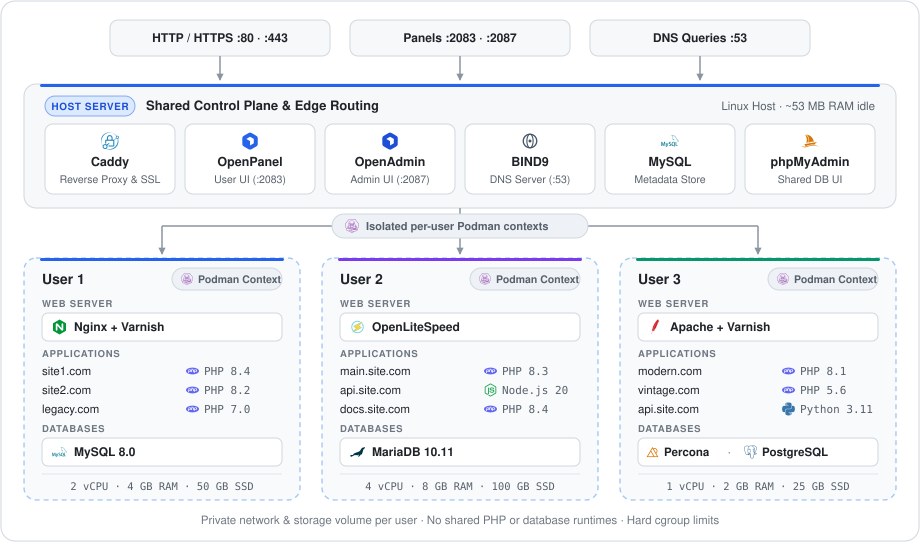

<div align="center">

<p align="center">
  <picture>
    <source media="(prefers-color-scheme: dark)" srcset="https://openpanel.com/img/svg/openpanel_white_logo.svg">
    
  </picture>
</p>

<h1>A hosting panel where<br>every user gets their own stack.</h1>

<h3>
Websites, domains, databases and backups in your browser — isolated in per-user containers.
</h3>

<h3>
<a href="#installation"><b>Get started</b></a> ·
<a href="https://openpanel.com/demo/"><b>Live demo</b></a> ·
<a href="https://openpanel.com/docs/admin/intro/"><b>Documentation</b></a> ·
<a href="https://discord.openpanel.com/"><b>Discord</b></a>
</h3>

<p>
<a href="#platform-capabilities">Capabilities</a> ·
<a href="#how-it-works">Architecture</a> ·
<a href="#multi-server-management">Multi-server</a> ·
<a href="#community-vs-enterprise">Community vs Enterprise</a> ·
<a href="#connect-your-ai-assistant-mcp">Connect AI</a> ·
<a href="#supported-os">Supported OS</a> ·
<a href="#faq">FAQ</a>
</p>

<p>
<a href="https://openpanel.com/docs/changelog/intro/"></a>
<a href="#supported-os"></a>
<a href="#installation"></a>
<a href="#how-it-works"></a>
<a href="#community-vs-enterprise"></a>
<a href="https://discord.openpanel.com/"></a>
</p>

<br>

<picture>
  <source media="(prefers-color-scheme: dark)" srcset="https://openpanel.com/img/openpanel-screenshots/dashboard/dashboard-window_dark.png">
  
</picture>
<br>
<a href="https://openpanel.com/demo/">Try the interactive live demo →</a>

</div>

---

## What is OpenPanel?

<!--start: description-->
**OpenPanel** is a web hosting control panel that uses containers to give every hosting user a completely isolated environment. Unlike traditional control panels that share a single Apache, MySQL, or PHP runtime across all users, OpenPanel provisions a dedicated Podman context per user: each with their own web server container, database container, PHP-FPM containers, private network, and storage volume.
The result: VPS-level isolation on shared hosting infrastructure, without the VPS price tag.
<!--end: description-->

In OpenPanel you can:

- Run an isolated **Apache, Nginx, OpenLiteSpeed or OpenResty** web server per account, optionally paired with **Varnish**
- Choose **MySQL, MariaDB or Percona** per user, alongside **PostgreSQL** and **MongoDB**
- Add domains with automatic **Let's Encrypt** SSL certificates and edit records in the **DNS Zone Editor**
- Install **WordPress**, Drupal, Joomla, Moodle or Nextcloud, or deploy sites from **Git**
- Set a **PHP version per domain** (from 5.6 to the latest release) and edit `php.ini` options from the browser
- Schedule self-service backups and restore files or databases in a few clicks
- Protect accounts with a per-domain web firewall, two-factor authentication, passkeys and malware scanning
- Connect an AI assistant over **MCP** to manage websites, domains and databases by chat *(Enterprise)*

> [!NOTE]
> **Community** is free forever for personal use (up to 3 user accounts and 50 domains). [**Enterprise**](https://openpanel.com/enterprise/) unlocks unlimited accounts, billing integrations, email hosting, Node.js/Python apps, white-label branding and MCP access, with a [30-day free trial](https://openpanel.com/trial).

## How it works

The host server runs OpenPanel, OpenAdmin, Caddy (reverse proxy and SSL), BIND9 (DNS), phpMyAdmin and metadata storage. When you create a hosting user, OpenPanel provisions an isolated Podman container context dedicated to that account, with its own CPU, RAM, disk, inode and network limits. Restarting or updating one user's stack never affects anyone else on the server.

<div align="center">
  <picture>
    <source media="(prefers-color-scheme: dark)" srcset=".github/assets/architecture-dark.svg">
    
  </picture>
</div>

### Lightweight footprint

The control panels stay small on the host, using roughly **53 MB of RAM at idle**, **324 MB on disk** and near-zero CPU.[^3]

<table>
<tr>
<td width="25%" align="center"><b>OpenPanel</b><br><code>~20 MB</code> RAM · <code>278 MB</code> disk</td>
<td width="25%" align="center"><b>OpenAdmin</b><br><code>~33 MB</code> RAM · <code>34.5 MB</code> disk</td>
<td width="25%" align="center"><b>OpenCLI</b><br>CLI binary · <code>11.4 MB</code> disk</td>
<td width="25%" align="center"><b>Total (Idle)</b><br><b><code>~53 MB</code> RAM · <code>~324 MB</code> disk</b></td>
</tr>
</table>

[^3]: Measured on OpenPanel 2.0.28. RAM is the resident memory of the `openpanel` and `openadmin` processes; the whole OpenPanel container uses ~119 MB with the tools it runs.

## Installation

Install on any supported Linux VPS or dedicated server (`x86_64` or `ARM64`, 1 GB+ RAM, 20 GB+ disk) with a single command:

```bash
bash <(curl -sSL https://openpanel.org)
```

For full installation options and configuration flags: [openpanel.com/install](https://openpanel.com/install) · [Resource calculator](https://openpanel.com/calculator/) · [System requirements](https://openpanel.com/docs/articles/install-update/system-requirements/)

## Platform Capabilities

<table>
<tr>
<td width="33%" valign="top">
<br>
<b>Per-User Web &amp; DB Stack</b><br><br>
Every account gets isolated <a href="https://openpanel.com/docs/articles/containers/how-to-set-nginx-apache-varnish-per-user-in-openpanel/">Apache, Nginx, OpenLiteSpeed or OpenResty</a> containers (with optional Varnish) plus dedicated <a href="https://openpanel.com/docs/articles/containers/how-to-set-mysql-mariadb-per-user-in-openpanel/">MySQL, MariaDB or Percona</a>, PostgreSQL and MongoDB.
</td>
<td width="33%" valign="top">
<br>
<b>Apps, Runtimes &amp; Git</b><br><br>
Built-in WordPress Manager, auto-installer for Drupal, Joomla, Moodle and Nextcloud, per-domain PHP (5.6–8.x), Git deploys, plus Node.js and Python apps in Enterprise.
</td>
<td width="33%" valign="top">
<br>
<b>Defense-in-Depth Security</b><br><br>
Per-domain Web Application Firewall, two-factor authentication, passkeys, IP blocker, malware scanner, strict cgroup limits and full <a href="https://openpanel.com/docs/panel/security/account_activity/">activity logs</a>.
</td>
</tr>
<tr>
<td width="33%" valign="top">
<br>
<b>Hosting Provider Toolkit</b><br><br>
Automated provisioning for <a href="https://openpanel.com/billing/whmcs-module/">WHMCS</a>, <a href="https://openpanel.com/billing/fossbilling-module/">FOSSBilling</a>, <a href="https://openpanel.com/billing/blesta-module/">Blesta</a>, <a href="https://openpanel.com/billing/clientexec-module/">ClientExec</a>, <a href="https://openpanel.com/billing/wisecp-module/">WISECP</a> and <a href="https://clientfence.com/">ClientFence</a>, multi-server cluster management, plus full <a href="https://openpanel.com/docs/articles/dev-experience/customizing-openpanel-user-interface/">white-label branding</a>.
</td>
<td width="33%" valign="top">
<br>
<b>Backups, Migrations &amp; Email</b><br><br>
User-driven <a href="https://openpanel.com/docs/panel/backups/">scheduled backups</a>, one-click restores, <a href="https://openpanel.com/docs/articles/transfers/import-cpanel-backup-to-openpanel/">cPanel</a> / <a href="https://github.com/stefanpejcic/CyberPanel-to-OpenPanel">CyberPanel</a> account imports and full Enterprise <a href="https://openpanel.com/docs/articles/user-experience/how-to-setup-email-in-openpanel/">email hosting</a>.
</td>
<td width="33%" valign="top">
<br>
<b>AI Assistant &amp; MCP Server</b><br><br>
Built-in <a href="https://openpanel.com/docs/panel/account/mcp/">Model Context Protocol (MCP)</a> endpoint with scoped, expiring, read-only or no-deletes tokens for Claude Code, Codex, Cursor and VS Code.
</td>
</tr>
</table>

<div align="center">
  <br>
  <a href="https://openpanel.com/docs/panel/applications/"></a>
  <br>
  <sub><b>WordPress, PHP, Nginx, Apache, OpenLiteSpeed, MySQL, MariaDB, PostgreSQL, MongoDB, Redis, Node.js, Python &amp; Git</b></sub>
</div>

## Community vs Enterprise

| Capability | Community | Enterprise |
|---|---|---|
| **User accounts** | Up to 3 | Unlimited |
| **Domains** | Up to 50 | Unlimited |
| **Per-user Podman containers & hard limits** | ✅ | ✅ |
| **Apache, Nginx, OpenLiteSpeed, OpenResty + Varnish** | ✅ | ✅ |
| **MySQL, MariaDB, Percona, PHP per domain, WordPress & Git** | ✅ | ✅ |
| **Email hosting, webmail & FTP accounts** | — | ✅ |
| **Containerized Node.js & Python applications** | — | ✅ |
| **cPanel / JetBackup 5 importer & white-label UI** | — | ✅ |
| **Multi-server management & account transfers** | — | ✅ |
| **API access, billing modules & AI Assistant (MCP)** | — | ✅ |
| **Price** | **Free forever** | Per-server license ([30-day trial](https://openpanel.com/trial)) |

Compare editions in detail: [Community vs Enterprise](https://openpanel.com/docs/articles/license/pricing/).

## OpenPanel vs OpenAdmin

<table>
<tr>
<td width="50%" valign="top">

<picture>
  <source media="(prefers-color-scheme: dark)" srcset="https://openpanel.com/img/openpanel-screenshots/applications/sites-list_dark.png">
  
</picture>

### OpenPanel

The client-level control panel on port `2083`. End users manage websites, domains, PHP versions, databases, backups, files and their own isolated containers.

[User panel documentation →](https://openpanel.com/docs/panel/intro/)

</td>
<td width="50%" valign="top">

<picture>
  <source media="(prefers-color-scheme: dark)" srcset="https://openpanel.com/img/openadmin-screenshots/001_dashboard-window_dark.png">
  
</picture>

### OpenAdmin

The administrator-level panel on port `2087`. Create and manage user accounts, configure hosting plans and resource limits, monitor the server and manage updates.

[Admin panel documentation →](https://openpanel.com/docs/admin/intro/)

</td>
</tr>
</table>

## Multi-server management

Manage multiple OpenPanel servers from a single **OpenAdmin** master under **System > Multi-server** *(Enterprise)*. Each server stays a complete, independent installation with its own users, domains, email and DNS — so slave servers continue running normally even if the master is unreachable.

- **Unified control:** Switch between servers from the sidebar, search across every node and view combined users, domains, services and usage.
- **Apply & sync everywhere:** Save settings across all servers at once or keep policies automatically synchronized from the master.
- **Move accounts between servers:** Transfer accounts across servers in your cluster directly from OpenAdmin.

<div align="center">
  <picture>
    <source media="(prefers-color-scheme: dark)" srcset="https://openpanel.com/img/openadmin-screenshots/multi-server/cluster-page_dark.png">
     Multi-server management dashboard" width="800">
  </picture>
  <br>
  <a href="https://openpanel.com/docs/admin/system/multi-server/">Multi-server documentation →</a>
</div>

## Connect your AI assistant (MCP)

OpenPanel Enterprise includes a built-in [Model Context Protocol (MCP)](https://openpanel.com/docs/panel/account/mcp/) server at `/mcp`, letting users manage sites, domains, DNS records, databases and logs from their AI assistant with scoped, revocable tokens (**Read-only**, **No deletes**, per-feature access and expiry).

<div align="center">
  <a href="https://openpanel.com/docs/panel/account/mcp/"></a>&nbsp;&nbsp;
  <a href="https://openpanel.com/docs/panel/account/mcp/"></a>&nbsp;&nbsp;
  <a href="https://openpanel.com/docs/panel/account/mcp/"></a>&nbsp;&nbsp;
  <a href="https://openpanel.com/docs/panel/account/mcp/"></a>
  <br>
  <sub><b>Claude Code · ChatGPT / Codex · Cursor · VS Code</b> · <a href="https://openpanel.com/docs/panel/account/mcp/">MCP documentation →</a></sub>
</div>

## Supported OS

OpenPanel is [OS-agnostic](https://www.techtarget.com/whatis/definition/agnostic) across current Debian and RHEL families:

- **AMD and Intel CPUs:** Ubuntu 24 is recommended.
- **ARM CPUs:** AlmaLinux 9.7 is recommended.

The install script is automatically tested against each distribution below:

<!-- OS_TEST_RESULTS_START -->
| Operating System | Version | Last Tested | Status | Average install time[^2] | Notes |
|---|---|---|---|---|---|
| Ubuntu | 24 | 2026-11-28 09:39 UTC | ✅ Pass | 2m26s | **recommended for AMD CPU** |
| Ubuntu | 26 | 2026-11-28 09:28 UTC | ✅ Pass | 4m31s |  |
| Debian | 12 | 2026-11-28 09:47 UTC | ✅ Pass | 2m47s |  |
| Debian | 13 | 2026-11-28 09:57 UTC | ✅ Pass | 2m27s |  |
| AlmaLinux | 9.7 | 2026-11-28 08:59 UTC | ✅ Pass | 8m3s | **recommended for ARM CPU** |
| AlmaLinux | 10 | 2026-11-28 08:42 UTC | ✅ Pass | 10m18s |  |
| OracleLinux | 10 | |  |  |  |
| RockyLinux | 9.6 | | | |  |
| RockyLinux | 10 | 2026-11-28 10:05 UTC | ✅ Pass | 12m28s |  |
| CentOS | 9.5 | | | |  |
| CentOS | 10 | 2026-11-28 09:12 UTC | ✅ Pass | 9m34s |  |

<!-- OS_TEST_RESULTS_END -->

[^2]: Average installation time for [the install script](https://openpanel.org/) on a VPS with 2 CPU cores and 2 GB of RAM.

## FAQ

<details>
<summary><b>Is OpenPanel free?</b></summary>

Yes. OpenPanel Community is free forever with no trial timer or credit card required, supporting up to 3 user accounts and 50 domains for personal use. For commercial hosting, [OpenPanel Enterprise](https://openpanel.com/docs/articles/license/pricing/) is licensed per server rather than per account.
</details>

<details>
<summary><b>Is OpenPanel open source?</b></summary>

The source code is published in this repository. OpenCLI and the configuration files are licensed under CC BY-NC 4.0, while the OpenPanel and OpenAdmin web interfaces are distributed under an End User License Agreement (EULA).
</details>

<details>
<summary><b>Can I use it to sell web hosting?</b></summary>

Yes, with OpenPanel Enterprise. It supports unlimited accounts, hosting plans, resellers, API access and billing modules for WHMCS, FOSSBilling, Blesta, ClientExec, WISECP and ClientFence. Community edition is for personal use only.
</details>

<details>
<summary><b>How do I log in after installation?</b></summary>

OpenAdmin runs on port `2087` and OpenPanel on port `2083` of your server's IP address. The installer prints the generated admin credentials upon completion, and you can later attach a custom domain to drop the port: [How to access OpenAdmin](https://openpanel.com/docs/articles/dev-experience/how-to-access-openadmin/).
</details>

<details>
<summary><b>Can I install it on shared hosting, Windows, or an OpenVZ/LXC container?</b></summary>

No. OpenPanel requires `root` access on a blank Linux full VM (KVM, VMware, Hyper-V) or bare metal server.
</details>

<details>
<summary><b>Can I migrate from cPanel or CyberPanel?</b></summary>

Yes. Enterprise imports [cPanel](https://openpanel.com/docs/articles/transfers/import-cpanel-backup-to-openpanel/) backups (including JetBackup 5 archives) directly from OpenAdmin, and [CyberPanel-to-OpenPanel](https://github.com/stefanpejcic/CyberPanel-to-OpenPanel) assists with CyberPanel migrations.
</details>

<details>
<summary><b>Does it include email hosting?</b></summary>

Yes, in Enterprise. Once enabled, it provides mailboxes, webmail, spam filtering and DKIM signing for all users on the server: [Enable email hosting](https://openpanel.com/docs/articles/user-experience/how-to-setup-email-in-openpanel/).
</details>

<details>
<summary><b>Does it use Docker or Podman?</b></summary>

Fresh installations of OpenPanel 2.0 and later use Podman, eliminating per-user background daemons to reduce RAM overhead. Older installations continue running user services in rootless Docker.
</details>

<details>
<summary><b>How do I update OpenPanel?</b></summary>

OpenAdmin notifies you when an update is available. Update from **Settings > Updates**, enable automatic updates, or run `opencli update --force`: [Updating manually](https://openpanel.com/docs/articles/install-update/how-to-manually-update-openpanel/).
</details>

<details>
<summary><b>How do I uninstall OpenPanel?</b></summary>

There is no uninstaller. Because OpenPanel configures system-wide containers, networking and services, reinstalling the OS is the only clean way to remove it.
</details>

<details>
<summary><b>Can one panel manage multiple servers?</b></summary>

Yes, with OpenPanel Enterprise. Connect additional OpenPanel servers under **System > Multi-server** in OpenAdmin to manage users, sync settings, restart services and move accounts across your cluster from one master login while each server remains self-contained: [Multi-server documentation](https://openpanel.com/docs/admin/system/multi-server/).
</details>

More answers are in the [full FAQ](https://openpanel.com/docs/articles/faq/).

## Documentation

| Section | What it covers |
|---|---|
| [OpenAdmin](https://openpanel.com/docs/admin/intro/) | Administrator panel setup, plans and user management |
| [OpenPanel](https://openpanel.com/docs/panel/intro/) | End-user panel guide for domains, apps, PHP and backups |
| [Guides and How-to](https://openpanel.com/docs/articles/intro/) | Step-by-step tutorials, security hardening and migrations |
| [OpenCLI](https://openpanel.com/docs/opencli/intro/) | Terminal commands and server administration |

## Version

Latest OpenPanel version is: **2.0.31** - [View Changelog](https://openpanel.com/docs/changelog/2.0.31/)

## Team

<table id="team">
<tr>
<td id="stefanpejcic" align="center" width="25%">
<a href="https://github.com/stefanpejcic">

</a>
<h4 align="center"><a href="https://pejcic.rs">Stefan Pejčić</a></h4>
</td>
<td id="radovanjecmenica" align="center" width="25%">
<a href="https://github.com/radovanjecmenica">

</a>
<h4 align="center"><a href="https://jecmenica.rs">Radovan Ječmenica</a></h4>
</td>
<td id="petar" align="center" width="25%">
<a href="https://github.com/p3t4rc">

</a>
<h4 align="center">Petar Ćurić</h4>
</td>
<td id="lazar" align="center" width="25%">
<a href="https://github.com/lazarunl">

</a>
<h4 align="center">Lazar K.</h4>
</td>
</tr>
</table>

Special thanks to all [contributors](https://github.com/stefanpejcic/OpenPanel/graphs/contributors) for extending and improving OpenPanel.

## Contribute & Security

- Read [CONTRIBUTING.md](https://github.com/stefanpejcic/OpenPanel/blob/main/CONTRIBUTING.md) to get started with pull requests and translations.
- To report a security vulnerability privately, follow [SECURITY.md](https://github.com/stefanpejcic/OpenPanel/blob/main/SECURITY.md).

## License

- OpenAdmin and OpenPanel UI are distributed under EULA.
- OpenCLI and configuration files are distributed under the Creative Commons Attribution-NonCommercial (CC BY-NC) license.

<br>

<div align="center">
  All OpenPanel documentation is hosted on <a href="https://openpanel.com/">openpanel.com</a> · <a href="https://openpanel.com/roadmap/">Roadmap</a>
</div>
